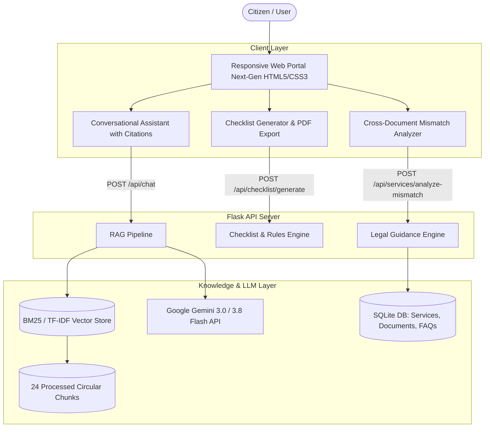

# 🇮🇳 Aadhaar, PAN and Passport Process Helper

<div align="center">


**An intelligent citizen advisory & workflow platform that eliminates government identity document rejections, demographic mismatches, and wasted physical appointments.**

[Key Features](#-key-features) • [System Architecture](#-system-architecture) • [Project Structure](#-project-structure) • [Quickstart](#-quickstart--local-setup) • [API Reference](#-api-endpoints) • [GitHub Push Guide](#-how-to-push-to-github)

</div>

---

## 📌 Problem & Motivation

Navigating primary Indian identity documents (**Aadhaar**, **PAN**, and **Passport**) is notorious for bureaucratic friction, confusing guidelines, and rejected applications:
* **The Root Anchor Problem:** Over 65% of passport rejections and PAN-Aadhaar linking errors stem from minor typographical differences (e.g., initials like *"R. K. Sharma"* on Aadhaar vs. full expanded names *"Ramesh Kumar Sharma"* on PAN or 10th certificates).
* **PAN-Aadhaar Linking Penalty:** Unlinked PAN cards become inoperative, subjecting citizens to 20% TDS and blocked tax refunds. Paying the ₹1,000 late fee challan under Minor Head 500 requires a confusing 24–48 hour sync wait.
* **Passport Seva Roadblocks:** Strict physical counter reviews (Counters A, B, and C) regularly reject applicants for invalid notary rental agreements, missing Non-ECR proof, or minor name discrepancies.

**This application provides a unified, rejection-proof web portal and RAG AI assistant that guides citizens through the exact legal hierarchy and documentation required.**

---

## ✨ Key Features

| Feature | Description |
| :--- | :--- |
| **🔍 Cross-Document Mismatch Analyzer** | Real-time diagnostic tool comparing 10th Marksheet, Aadhaar, and PAN. Automatically identifies initial expansions, single-name issues ("FNU"), and Date of Birth mismatches with an actionable legal roadmap. |
| **📋 Dynamic Checklist Generator** | Tailored document checklist wizard for Fresh/Reissue/PCC Passports, Normal vs. Tatkaal schemes, and Non-ECR status with `localStorage` state saving and one-click PDF printing. |
| **🤖 Grounded RAG AI Assistant** | Conversational assistant powered by Google Gemini and backed by an offline-capable BM25/TF-IDF vector store indexed across 24 official circulars. |
| **🗺️ The Golden Order Roadmap** | Visual legal hierarchy: Root Anchor (10th/Birth Cert) $\rightarrow$ Aadhaar update $\rightarrow$ PAN alignment $\rightarrow$ Rejection-free Passport application. |
| **📜 Legal Templates** | Standard pre-formatted affidavit and deed poll templates for minor spelling changes and marriage surname adjustments (Annexure D). |
| **⚡ Instant e-PAN & PVC Guides** | Clear separation between free instant digital e-PAN, Form 49A physical cards, and UIDAI durable PVC card orders. |

---

## 🏗️ System Architecture



---

## 📂 Project Structure

```
aadhaar-pan-passport-helper/
├── frontend/
│   ├── pages/
│   │   ├── index.html           # Landing page with Mismatch Analyzer tool
│   │   ├── aadhaar.html         # Aadhaar enrollment, updates, limits (2x/1x) & MBU rules
│   │   ├── pan.html             # Instant e-PAN, Form 49A & PAN-Aadhaar linking guide
│   │   ├── passport.html        # Normal vs Tatkaal scheme & custom checklist wizard
│   │   ├── process-guide.html   # The Golden Order roadmap & Affidavit templates
│   │   ├── faq.html             # Searchable categorized FAQs
│   │   └── chatbot.html         # RAG-powered identity assistant with prompt chips
│   ├── css/
│   │   ├── style.css            # Design system, cards, forms, animations & print CSS
│   │   └── responsive.css       # Mobile & tablet responsiveness
│   ├── js/
│   │   ├── main.js              # Nav state & cross-document discrepancy analyzer
│   │   ├── checklist.js         # Interactive checklist wizard, localStorage & PDF print
│   │   └── chatbot.js           # Conversational chat UI & grounding source citations
│   └── assets/
│       ├── icons/logo.svg       # Brand logo
│       └── images/
├── backend/
│   ├── app.py                   # Flask server, static router & API orchestrator
│   ├── config.py                # Environment & directory configurations
│   ├── requirements.txt         # Python dependencies
│   ├── .env                     # Local secrets (ignored by Git for privacy)
│   ├── .env.example             # Example environment template
│   ├── database/
│   │   ├── schema.sql           # SQLite schema (services, docs, rules, FAQs)
│   │   ├── db.py                # SQLite connection & query helpers
│   │   ├── seed_data.py         # Seed script with verified government rules
│   │   └── identity_helper.db   # Seeded SQLite database
│   ├── knowledge_base/
│   │   ├── documents/           # Official Markdown guidelines (Aadhaar, PAN, Passport, Mismatches)
│   │   ├── processed/chunks.json# 24 tokenized knowledge chunks
│   │   ├── ingest.py            # Chunker and document processor
│   │   ├── vector_store.py      # Pure-Python BM25/TF-IDF vector store
│   │   └── retriever.py         # Context retriever
│   ├── routes/
│   │   ├── services.py          # /api/services, /api/services/analyze-mismatch, /api/faqs
│   │   ├── checklist.py         # /api/checklist/generate, /api/checklist/documents
│   │   └── chatbot.py           # /api/chat & /api/chat/suggestions
│   └── services/
│       ├── guidance_service.py  # Legal logic for mismatch analysis & checklists
│       ├── llm_service.py       # Gemini API caller + expert domain synthesizer
│       └── rag_service.py       # End-to-end RAG pipeline
├── tests/
│   ├── test_services.py         # 5 tests: services API, mismatch analysis, FAQs
│   ├── test_checklist.py        # 4 tests: checklist generation & document categories
│   └── test_chatbot.py          # 4 tests: vector search & RAG endpoints
├── README.md                    # Project documentation
└── .gitignore                   # Git ignore rules
```

---

## 🚀 Quickstart & Local Setup

### Prerequisites
* **Python 3.10+** (Tested on Python 3.10 – 3.14)
* **Git** installed on your system
* Modern web browser (Chrome, Edge, Firefox, Safari)

### 1. Clone the Repository
```bash
git clone https://github.com/<your-username>/<your-repo-name>.git
cd aadhaar-pan-passport-helper
```

### 2. Configure Environment Variables
Copy `.env.example` to `.env`:
```bash
cp backend/.env.example backend/.env
```
Open `backend/.env` and add your Google Gemini API key:
```properties
PORT=5000
DEBUG=True
GEMINI_API_KEY=your_gemini_api_key_here
```
*(Get a free API key at [Google AI Studio](https://aistudio.google.com/)).*

### 3. Install Python Dependencies
```bash
cd backend
pip install -r requirements.txt
```

### 4. Run the Web Application
```bash
python app.py
```
Open your browser and navigate to:
👉 **`http://127.0.0.1:5000`**

*(Note: The frontend pages can also be run directly by opening any `.html` file from `frontend/pages/` in your browser. All client-side fallbacks are pre-wired).*

---

## 🧪 Automated Testing

Run the full automated test suite (13 unit and integration tests):
```bash
python -m unittest discover -s tests -p "test_*.py"
```
**Test Results:**
```
Ran 13 tests in 0.080s
OK
```

---

## 🔌 API Endpoints

| Method | Endpoint | Description |
| :--- | :--- | :--- |
| `GET` | `/api/health` | Health check endpoint. |
| `GET` | `/api/services` | Retrieve identity services (optional query `?category=aadhaar\|pan\|passport`). |
| `GET` | `/api/services/<code>` | Detailed requirements and acceptable documents for a specific service. |
| `POST` | `/api/services/analyze-mismatch` | Analyze names and DoBs across 10th cert, Aadhaar, and PAN. |
| `POST` | `/api/checklist/generate` | Generate personalized document checklist, fee estimate, and timeline. |
| `GET` | `/api/checklist/documents` | Master catalog of acceptable proofs (PoI, PoA, PoB, Non-ECR). |
| `POST` | `/api/chat` | RAG-grounded conversational answers with official citations. |
| `GET` | `/api/chat/suggestions` | Suggested question prompt chips. |
| `GET` | `/api/faqs` | Searchable FAQs with optional filters (`?category=` or `?q=`). |

---

## 📤 How to Push to GitHub

To push this codebase to your own GitHub repository:

### Step 1: Open PowerShell or Terminal in the Project Root
```powershell
cd C:\Users\syamb\.gemini\antigravity\scratch\aadhaar-pan-passport-helper
```

### Step 2: Initialize Git & Commit Files
```powershell
git init
git add .
git commit -m "feat: complete aadhaar, pan and passport process helper web app"
```
*(Note: Your `.env` containing your private API key is automatically ignored by `.gitignore` so your credentials are never exposed).*

### Step 3: Link Your GitHub Repository and Push
Replace `<YOUR_GITHUB_REPO_URL>` with your repository's URL (e.g. `https://github.com/yourusername/aadhaar-pan-passport-helper.git`):
```powershell
git branch -M main
git remote add origin <YOUR_GITHUB_REPO_URL>
git push -u origin main
```
> **Tip:** If prompted by Windows for credentials, sign in with your GitHub account in the browser prompt or enter your GitHub Personal Access Token (PAT).

---

## ⚖️ Legal & Privacy Disclaimer

* **Independent Resource:** This portal is an independent educational assistance tool. It is **not** an official portal of UIDAI, the Income Tax Department, or the Ministry of External Affairs.
* **Official Submissions:** All official applications must be submitted directly through official government portals:
  * UIDAI: [myaadhaar.uidai.gov.in](https://myaadhaar.uidai.gov.in/)
  * Income Tax e-Filing: [eportal.incometax.gov.in](https://eportal.incometax.gov.in/)
  * Passport Seva: [passportindia.gov.in](https://www.passportindia.gov.in/)
* **Data Privacy (DPDP Compliance):** This application does not store, transmit, or record 12-digit Aadhaar numbers, biometric scans, or permanent personal identifiers. All diagnostic calculations run ephemerally.

---

## 📄 License

This project is licensed under the [MIT License](LICENSE).
